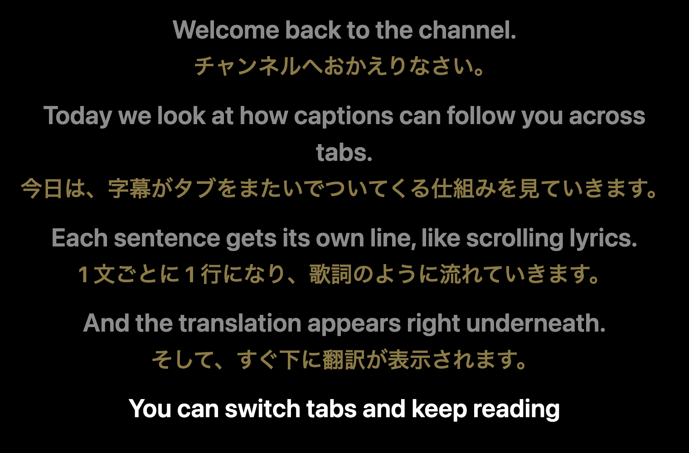
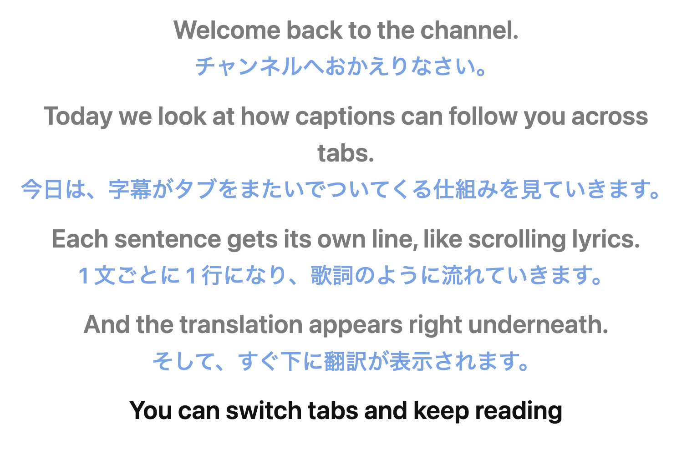

# YouTube 字幕オーバーレイ(日英)

[English](README.md)

YouTube の字幕を、**最前面に浮かぶ小窓**に表示する Chrome 拡張機能です。字幕は歌詞のように**1 行 = 1 文**で上から下へ積まれ、各行の下に**日本語訳**が付きます。別のタブや別のアプリに移っても、小窓は見え続けます。

<p align="center">
  
  
</p>

<sub>画像の例文は、このプロジェクトのために書いたものです。動画から取ったものではありません。</sub>

- **1 行 = 1 文**: 字幕を文にまとめて積みます。一番新しい行が濃く、過去の行は薄くなります
- **各行の下に日本語訳**: Chrome 内蔵の翻訳 API で、端末内で訳します。外部には何も送信しません
- **自動生成字幕にも対応**: 句読点がなくても、話の切れ目で行を区切ります
- **他のタブ・アプリの上に残る**(Document Picture-in-Picture)
- 文字サイズの調整、ライト/ダークの切替、日本語訳の表示/非表示

## 動作要件

| 機能 | 必要なもの |
| --- | --- |
| 小窓の表示 | Chrome 116 以降(Document Picture-in-Picture) |
| 日本語訳 | Chrome 138 以降(Translator API)・デスクトップ版 |

Firefox / Safari は非対応です。

## インストール

Chrome ウェブストアにはまだ公開していません。リリースの zip から入れてください。

1. [Releases のページ](https://github.com/fatcorn753/youtube-bilingual-caption-overlay/releases/latest)から `bilingual-caption-overlay-<バージョン>.zip` をダウンロードする
2. ずっと置いておくフォルダに展開する(Chrome はそのフォルダから拡張を読み込むので、削除しないでください)
3. `chrome://extensions` を開き、**デベロッパーモード**をオンにする
4. **パッケージ化されていない拡張機能を読み込む**で、手順 2 のフォルダを選ぶ

更新するときは、新しい zip をダウンロードしてフォルダの中身を入れ替え、拡張のカードで**再読み込み**を押します。

ソースから入れたい場合は、`git clone https://github.com/fatcorn753/youtube-bilingual-caption-overlay` して、クローンしたフォルダで手順 3〜4 をしてください。

## 使い方

1. 字幕のある YouTube の動画を開く
2. プレイヤーの CC ボタンのすぐ左にある **字幕オーバーレイ** ボタンを押す
3. 小窓が開く。カーソルを乗せると操作ボタンが出る

| ボタン | 動作 |
| --- | --- |
| `A−` / `A+` | 文字を小さく / 大きく |
| `JA` | 日本語訳の表示 / 非表示 |
| `◐` | ダーク / ライトの切替 |

小窓を開いている間は、YouTube 本体の字幕は隠れ、CC は(オフなら)自動でオンになり、動画に英語のトラックがあれば字幕の言語が**英語**に切り替わります(YouTube が日本語やドイツ語などを選んでいると、訳す元の英語がないため)。閉じると、すべて元に戻ります。次の動画へ進んでも、小窓は開いたまま、同じように準備されます。

履歴を上にスクロールして読んでいる間は、新しい行が来ても自動スクロールしません。一番下に戻すと追従を再開します。履歴は最大 300 行で、動画を切り替えるとリセットされます。

### 日本語訳が出ないとき

小窓の一番下の小さな帯に、理由が出ます。`JA` ボタンを 2 回押すと、やり直します。

| 表示 | 意味 |
| --- | --- |
| 翻訳を準備中… | 翻訳モデルを用意しています |
| 翻訳モデルをダウンロード中… NN% | 初回のみ |
| この環境では翻訳 API が使えません | Chrome 138 以降が必要です |
| 翻訳モデルを利用できません (en→ja) | `chrome://on-device-translation-internals` を確認してください |
| 翻訳エラー: … | エラー名と内容です(詳細はコンソールにも出ます) |

## 仕組み

プレイヤーから字幕のテキストを読み、文にまとめます。文末記号(`.` `?` `!` `。` など)で文を確定し、複数の字幕にまたがる文は 1 行につなぎます。句読点のない自動生成字幕は、話が止まったとき(約 1.5 秒)や、行が長くなりすぎたときに区切ります。

設計の詳細は [docs/ARCHITECTURE.md](docs/ARCHITECTURE.md) にあります。

## 制約

- **字幕は YouTube のページから読んでいます**。YouTube の構造が変わると、[`src/youtube.js`](src/youtube.js) のセレクタを直すまで動かなくなる可能性があります。YouTube 公式の字幕ファイルは、取得に証明トークンが要り、空で返るため使えません
- 訳は **機械翻訳**(Chrome の端末内モデル)です
- 文の区切りは英語と日本語に合わせて調整しています。他の言語でも動きますが、区切りの精度は下がることがあります
- 略語の一覧(`Mr.` `Dr.` `e.g.` など)は小さいものです。載っていない略語の後ろで、文が早く切れることがあります

## 開発

ビルドも依存パッケージも不要です。テストの実行に Node.js 20 以降を使います。

```sh
npm test         # 単体テスト(Node 標準のテストランナー)
npm run pack     # dist/bilingual-caption-overlay-<version>.zip を作る
```

YouTube を開かずに動作を試すには、リポジトリを配信して、テスト用ハーネス(偽のプレイヤーと偽の小窓)を開きます。

```sh
python3 -m http.server 8000
# Chrome で http://localhost:8000/test/manual/harness.html を開く
```

プルリクエストの前に、[CONTRIBUTING.md](CONTRIBUTING.md) を読んでください。

## プライバシー

データの収集も、ネットワーク通信も行いません。設定(文字サイズ・テーマ・翻訳の on/off)は、ブラウザ内にだけ保存します。詳しくは [PRIVACY.md](PRIVACY.md) を参照してください。

## ライセンス

[MIT](LICENSE)

このプロジェクトは、YouTube および Google とは無関係で、承認・後援も受けていません。「YouTube」は Google LLC の商標です。この拡張は、利用者が自分のブラウザで見ている字幕を読むだけです。
